# Poly Lab · Interior Renovation Studio

**English** · [简体中文](README.zh-CN.md)

Poly Lab is a local workbench for planning a room renovation with the furniture you already own and the pieces you are considering. Draw a floor plan or start with a phone video, add objects at real dimensions, and try different arrangements before moving or buying anything.

[Home](#home) · [Asset library](#asset-library) · [Room builder](#room-builder) · [Design studio](#design-studio) · [Service settings](#service-settings) · [Quick start](#quick-start)

## Home

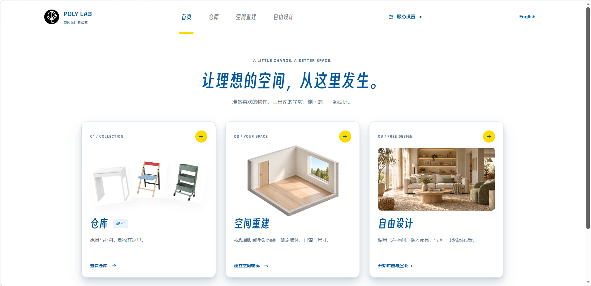

The three cards on the homepage follow the main workflow. **Library** holds furniture and materials, **Room Builder** defines the walls and openings, and **Design Studio** opens saved spaces for furniture placement and rendering. **Service Settings** in the header connects the optional AI providers.

You can start with an empty room from the space albums and try the tools before adding your own measurements. Use **English / 中文** in the header to switch languages. The browser remembers your choice.

## Asset library

The library holds reusable furniture, objects, and finishes. A fresh library includes the IKEA MICKE desk, PS 2026 folding chair, and RÅSHULT utility cart. You can search the library, preview an item in 3D, and edit its information as you collect your own pieces. Listed prices are reference values in CNY.

| Add assets from photos or video | Calibrate the model before saving |
| --- | --- |
| 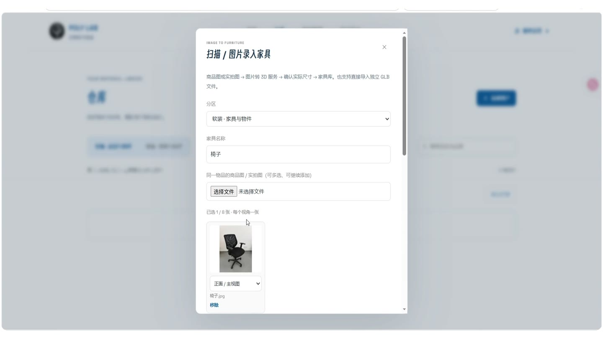 | 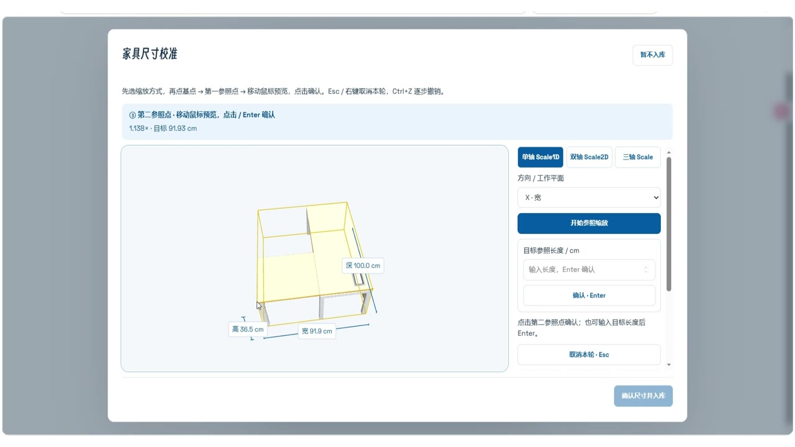 |

**Add Asset** offers four ways to enter a piece.

| Method | When to use it |
| --- | --- |
| Simple model | Enter the dimensions of a desk, cabinet, or similar item and start arranging it without an AI service. |
| Photo or video to 3D | Add photos of the same object or pick multiple frames from a short video. Multi-view generation depends on the selected model. |
| GLB import | Bring in an existing model and confirm its width, depth, and height against measurements. |
| Wall and floor material | Record a color, pattern or reference photo, material properties, and an optional price per square metre. |

The creation form accepts a name, a reference price, and an optional HTTPS product URL. Furniture can be floor-mounted, wall-mounted, ceiling-mounted, or freely positioned. For an imported or generated model, check the scale in the 3D calibration preview before adding it to the library.

## Room builder

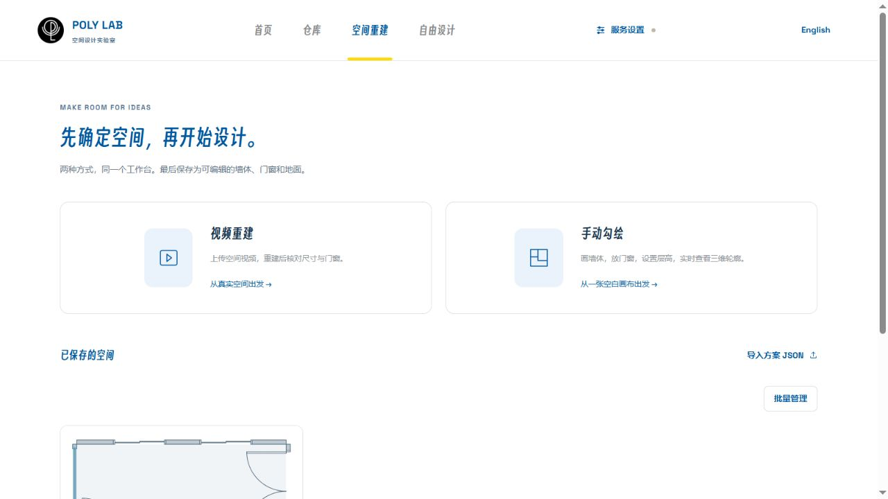

### Draw a floor plan

Start from a room template or draw wall segments at measured lengths. Set the wall thickness and ceiling height, place doors and windows on their host walls, then check the result in 3D. Door and window dimensions stay editable after placement.

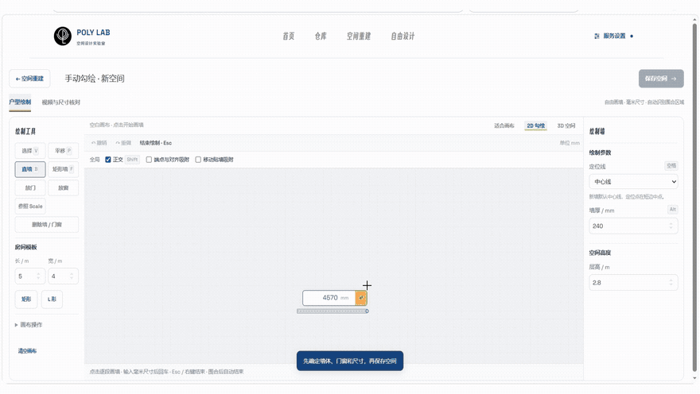

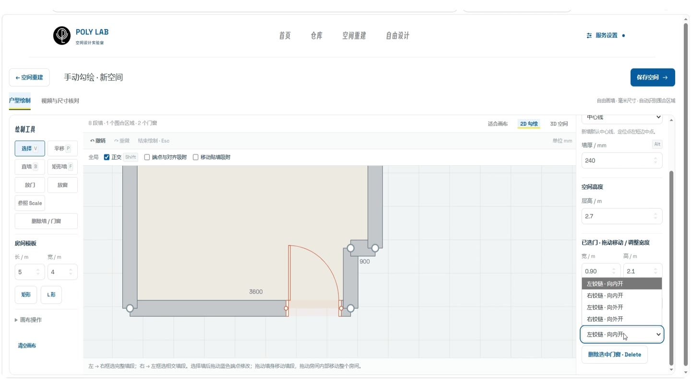

### Build from a phone video

Select a video and adjust the number of frames or the time interval between them. **Auto-Build Room** sends selected frames to the configured vision model and creates an editable draft with walls, openings, and furniture. Use simple objects to check the layout quickly. Detailed furniture generation uses the separate image-to-3D service.

Compare the draft with the frames and your on-site measurements. Use **Reference Scale** with a known wall length, then verify the ceiling height, door and window positions, and furniture sizes before saving the room.

## Design studio

### Arrange and compare layouts

Each space album can contain several independent designs. Duplicate a design to keep the current arrangement while exploring a new one. Add furniture from the library and use the placement tools to move, rotate, or raise it. The 2D plan is useful for checking footprints and door swings. The 3D view shows how the pieces relate in height. Turn on labels to identify objects in plan view or lower **Display Quality** while editing a heavy scene.

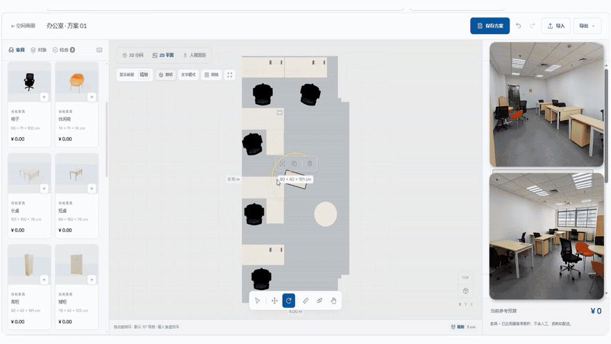

| 2D floor plan | 3D cutaway |
| --- | --- |
| 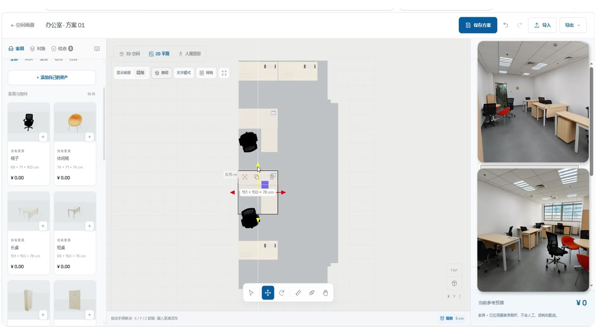 | 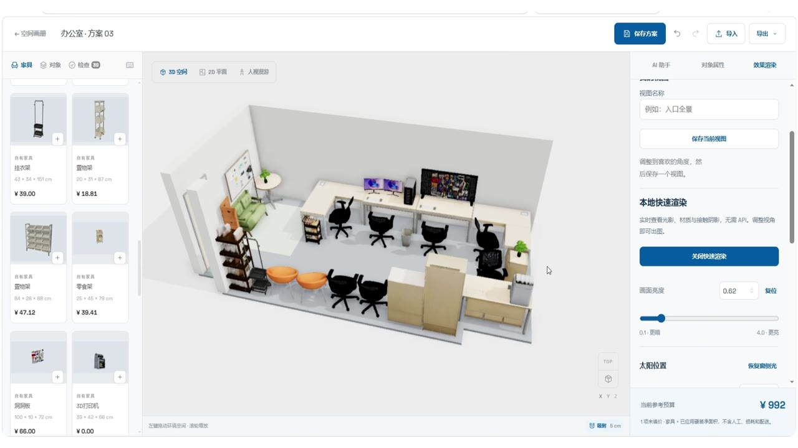 |

### Ask AI for a layout proposal

Describe what the room needs to do, which pieces to keep, and where you want clear circulation. For an office, you might ask for a hardware workbench and a filming corner while keeping the existing furniture. Review the proposed object changes before applying them to the 3D scene. Applied changes can be undone or refined by hand.

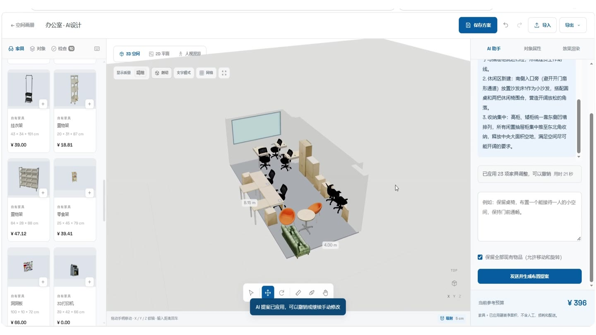

### Walk through and render

Switch to the eye-level view to inspect the room from inside. Adjust camera height and focal length, then use the keyboard and mouse to walk around. In **AI Rendering**, capture the current view and describe the lighting, finishes, or mood you want. Open the generated concept image to zoom in and download it. Use the editable scene and your measurements for dimensions when you carry out the renovation.

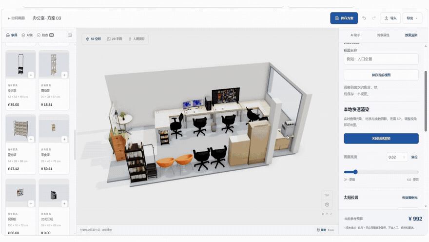

| Eye-level scene | Generated concept render |
| --- | --- |
| 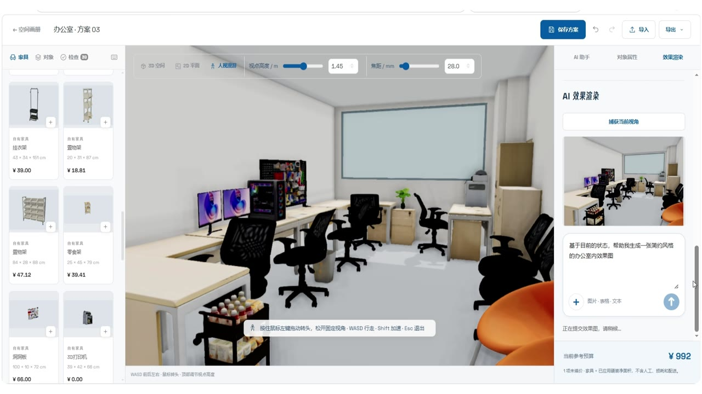 | 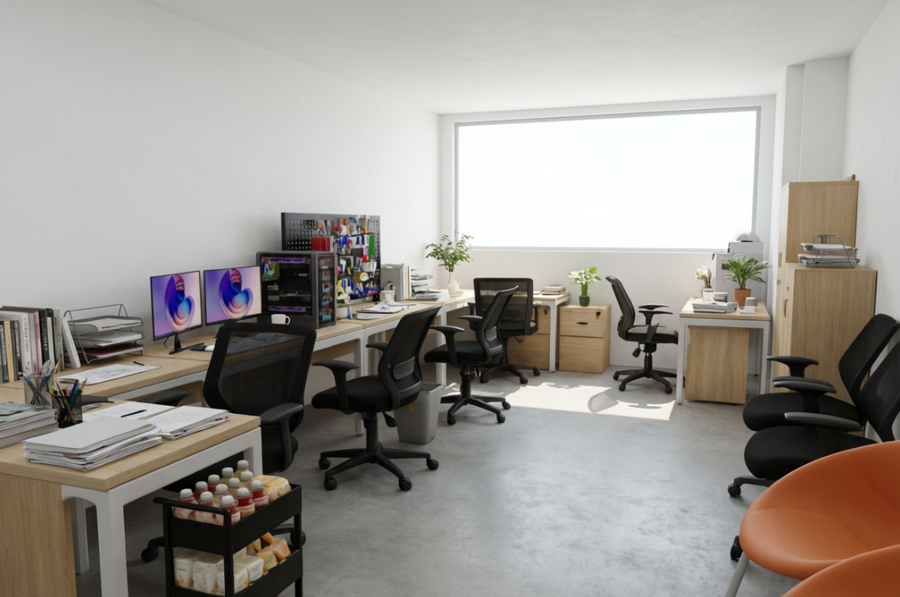 |

| Reception and filming area | Office overview |
| --- | --- |
| 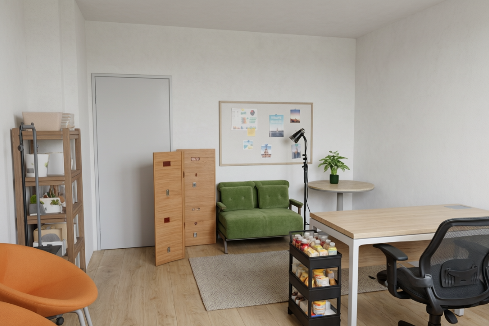 | 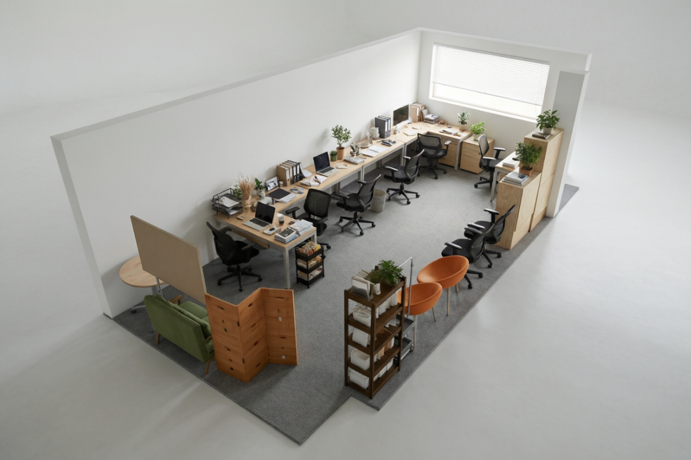 |

Save each design to its album. Use **Export JSON** to back up the editable plan or **Export GLB** to take the 3D model into another tool.

## Service settings

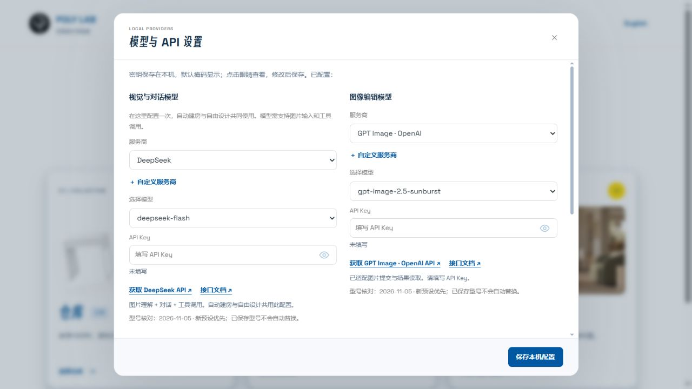

The three service settings are independent. Manual drawing, furniture placement, simple assets, and GLB imports can run locally without an API key. Configure only the services you intend to use.

| Service | What uses it |
| --- | --- |
| Vision and chat | Reading room video frames and generating layout proposals. Automatic room building needs a model that supports image input and tool calls. |
| Image to 3D | Generating furniture models from reference images. The library can submit jobs, check their status, and download the resulting GLB. |
| Image editing | Generating concept renders from a captured 3D view and optional references. |

API keys are stored in `.env.local` on the machine running the workbench. Projects and custom assets are stored in the current browser. AI requests send the selected inputs to the provider you configured. Keep JSON backups of designs you want to move or recover.

## Quick start

Install **Node.js 24.12 or newer** and use a modern browser with WebGL support. Run these commands in the repository folder.

```sh
npm ci
npm run build:studio
npm start
```

Open the local workbench and select **English** in the header. On Windows, you can also double-click `启动工作台.cmd` after the first build. For video decoding, model calibration, provider troubleshooting, and backup details, see the user guide. [Open the local workbench](http://127.0.0.1:8765/) · [User guide in Chinese](docs/使用手册.md)

## Development

```sh
npm run build:studio
npm run test:studio
npm run test:workflow
npm run test:geometry
npm run test:furniture
```

The workbench lives in `scripts/studio/`, with shared geometry in `scripts/` and public samples in `examples/`. The images show the workbench and its generated concept renders. The GIFs come from the Poly Lab promotional video.

[MIT License](LICENSE) · [Third-party notices](THIRD_PARTY_NOTICES.md)
