# Poly Lab · 室内改造工作台

[English](README.md) · **简体中文**

Poly Lab 是一套在本机运行的室内改造工作台。拿手机拍一段房间视频，或用尺子量出墙长手动画图，把现有家具和看中的商品按实际尺寸摆进去。桌子挪完之后门能不能开，椅子拉出来会不会挡路，都可以先在方案里看一遍。

[首页](#首页) · [仓库](#仓库) · [空间重建](#空间重建) · [自由设计](#自由设计) · [服务设置](#服务设置) · [本地启动](#本地启动)

## 首页

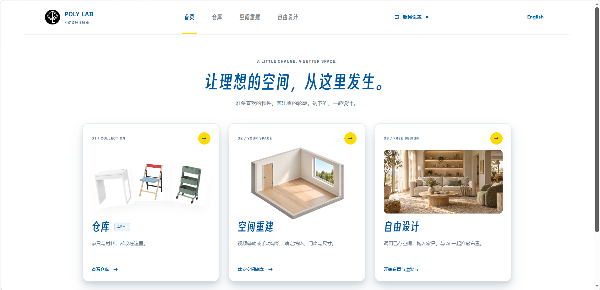

首页的三张卡片对应改造的三步。仓库用来收集家具和材料，空间重建用来确定墙体、门窗和尺寸，自由设计用来布置家具、保存不同方案和出效果图。右上角的「服务设置」可以配置需要的 AI 服务。

第一次打开，可以进空间画册用示例空房练习。顶部的 **English / 中文** 按钮可以随时切换界面语言，刷新后会保留上次的选择。

## 仓库

仓库分为家具与物件、墙地与构件。初始有宜家 MICKE 米克书桌、PS 2026 折叠椅和 RÅSHULT 拉舍推车。自有家具录入后也可以搜索、打开三维预览和编辑资料。商品价格是录入时的参考价，单位为人民币。

| 从照片或视频录入 | 在三维预览里核对尺寸 |
| --- | --- |
| 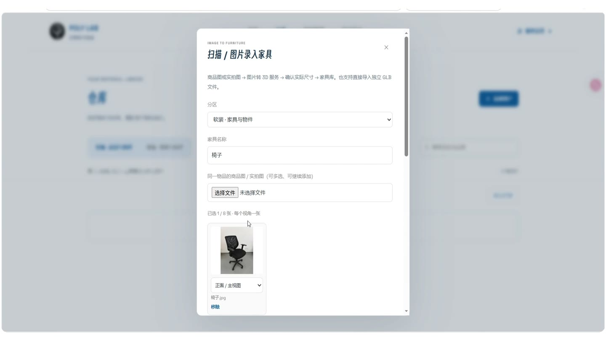 | 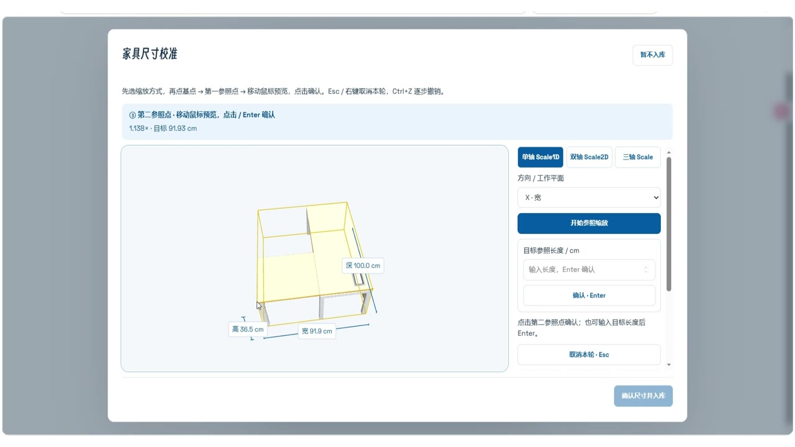 |

点「添加资产」后，可以按手里已有的材料选择录入方式。

| 录入方式 | 怎么用 |
| --- | --- |
| 按尺寸建立简模 | 手里只有宽、深、高时，先建一个能占位的模型。量过的书桌和柜子可以直接摆进方案。 |
| 照片或视频转三维 | 选同一物件的不同角度照片，或从一段视频里挑多帧。能否同时使用多张参考图取决于所选模型。 |
| 导入 GLB | 导入已有模型，再对照实测尺寸校准宽、深、高。 |
| 新增墙地材料 | 记录基础颜色、纹理或材质参考图，按需填写每平方米参考价。 |

创建时就能填写名称、参考价格和 HTTPS 商品链接。家具可选落地、挂墙、顶装或自由搭配。导入或生成的模型，建议在三维预览里核对尺寸后再入库。

## 空间重建

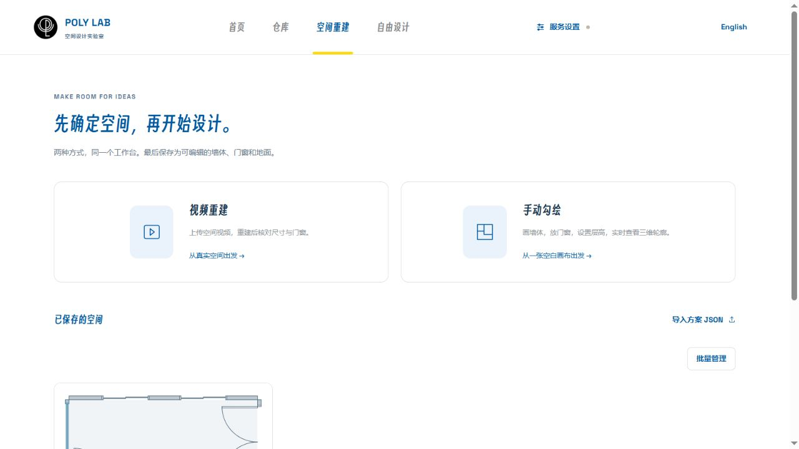

### 手动画户型

可以从矩形或 L 形模板开始，也可以逐段画墙。设好墙厚和层高后，把门窗放在对应的墙上，再切到三维看一遍。门窗放好后，仍能改位置、大小和门的开启方向。

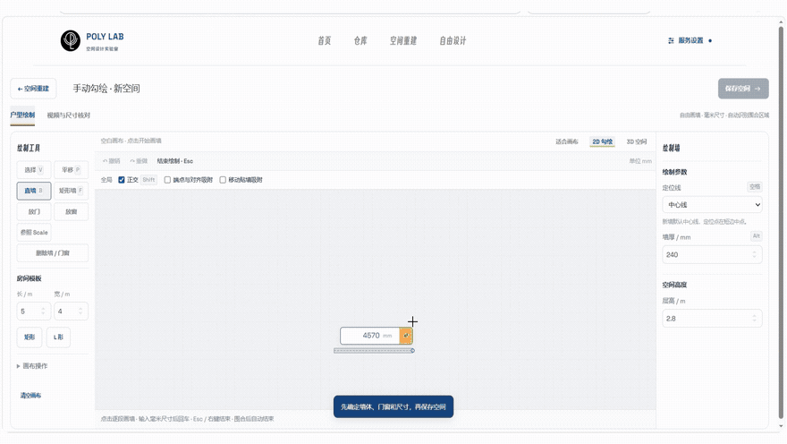

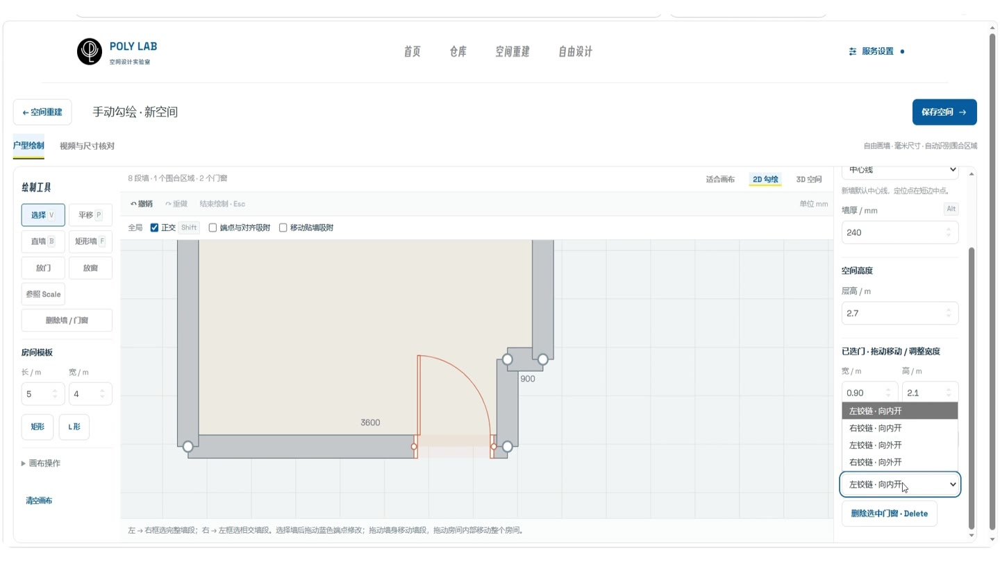

### 用手机视频建房

选一段视频，按数量或间隔抽取关键帧。点击「AI 自动建立房间」后，视觉模型会读这些画面，生成可编辑的墙体、门窗和家具草稿。想先看空间关系，可以选组合简模。需要更细的家具网格时，再用配置好的图片转三维服务生成。

建完先对照视频和实测数据。用一段量过的墙长做「参照 Scale」，然后检查层高、门窗位置和已有家具的尺寸，确认后再保存空间。

## 自由设计

### 摆家具和对比方案

一个空间可以保存多份设计。想试另一种排法，可以先复制方案，再从左侧仓库添加家具，用移动、旋转和底高工具调整。在 2D 平面里看占地和开门范围，在 3D 里看物件之间的高低关系。需要辨认物件时打开「文字模式」，模型较重时可以手动降低「显示质量」。

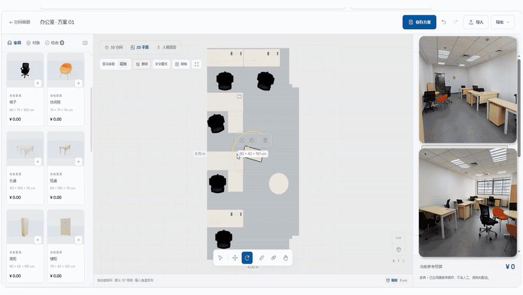

| 2D 平面布置 | 3D 剖切总览 |
| --- | --- |
| 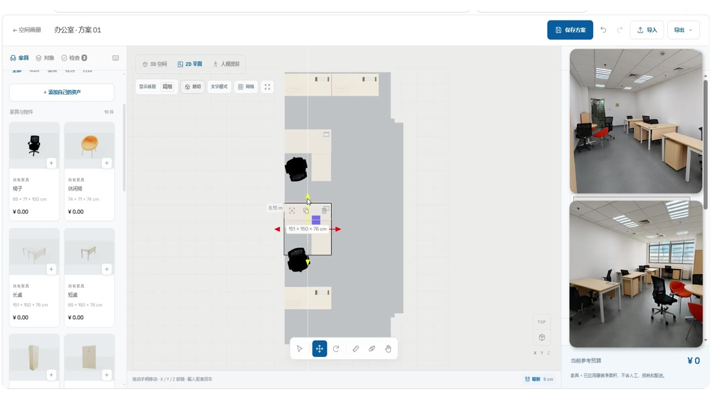 | 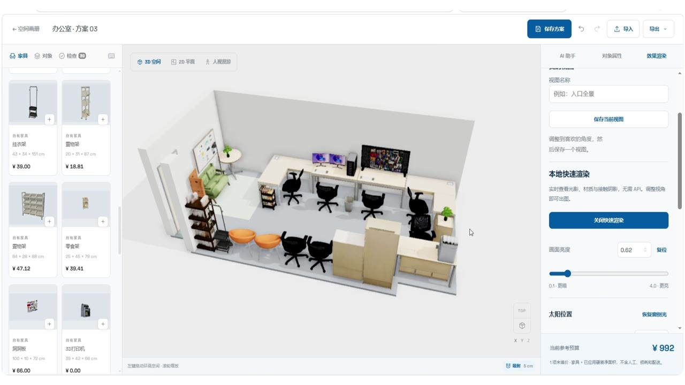 |

### 让 AI 提一版布置

告诉 AI 这间房要做什么、哪些家具得留下、哪里需要留通道。比如要在办公室里加硬件工作台和直播角，同时保留现有家具。收到提案后，可以先看它准备怎么调整，再应用到三维空间。应用后的调整可以撤销，也可以接着手动改。

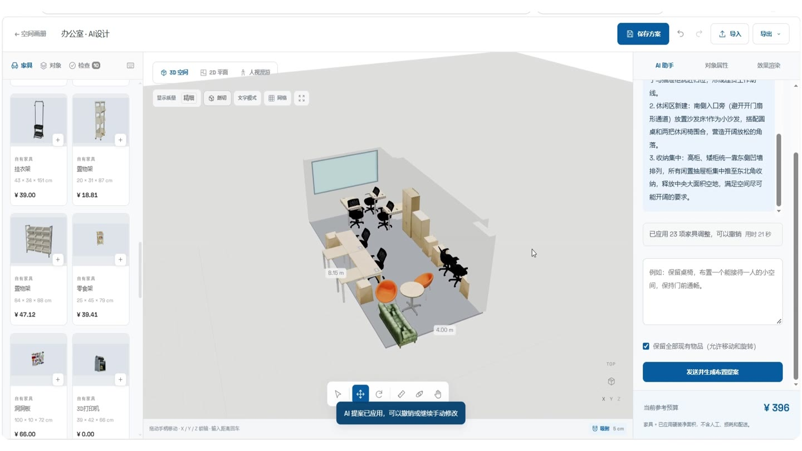

### 人视漫游和效果图

切到「人视漫游」，调整视点高度和焦距，再用键鼠在房间里转一圈。找到想看的角度后，在「AI 效果渲染」里捕获当前视角，写清想试的光线、材质或风格。生成的图可以点击放大、缩放和下载。实际布置时，用测过的尺寸和三维方案来定位家具。

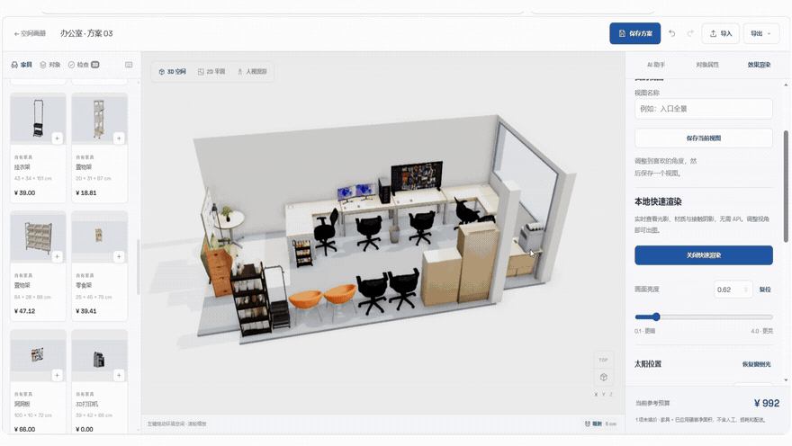

| 工作台人视角 | 放大后的 AI 效果图 |
| --- | --- |
| 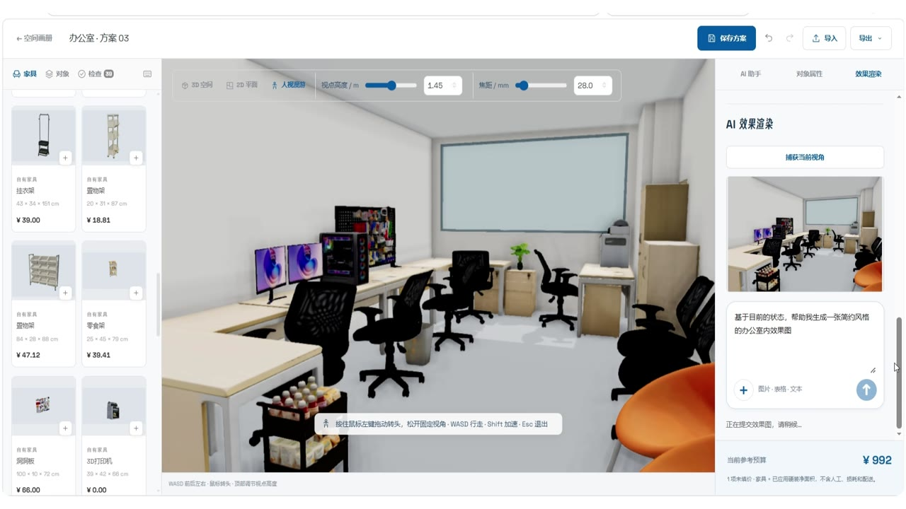 | 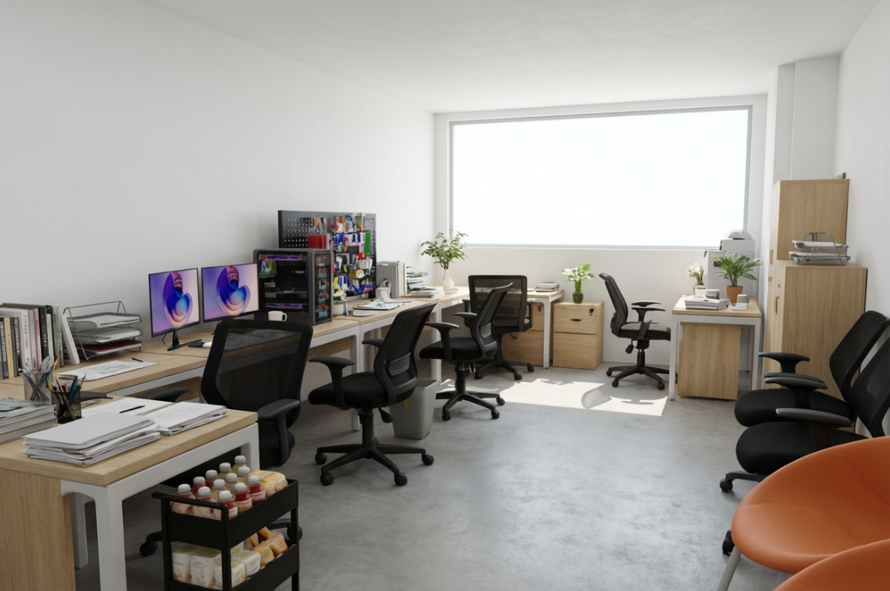 |
| 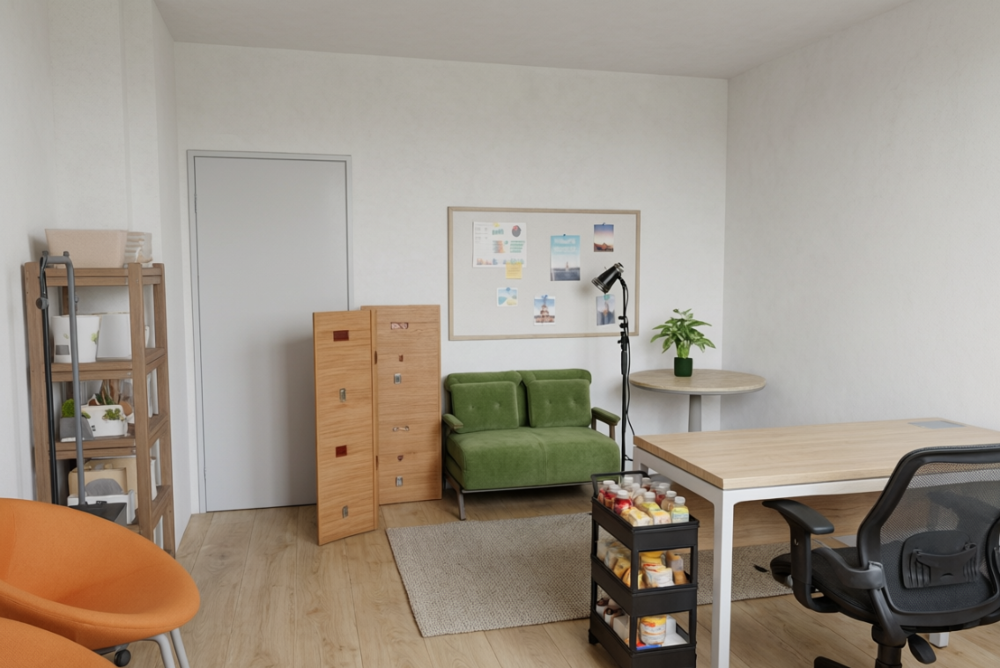 | 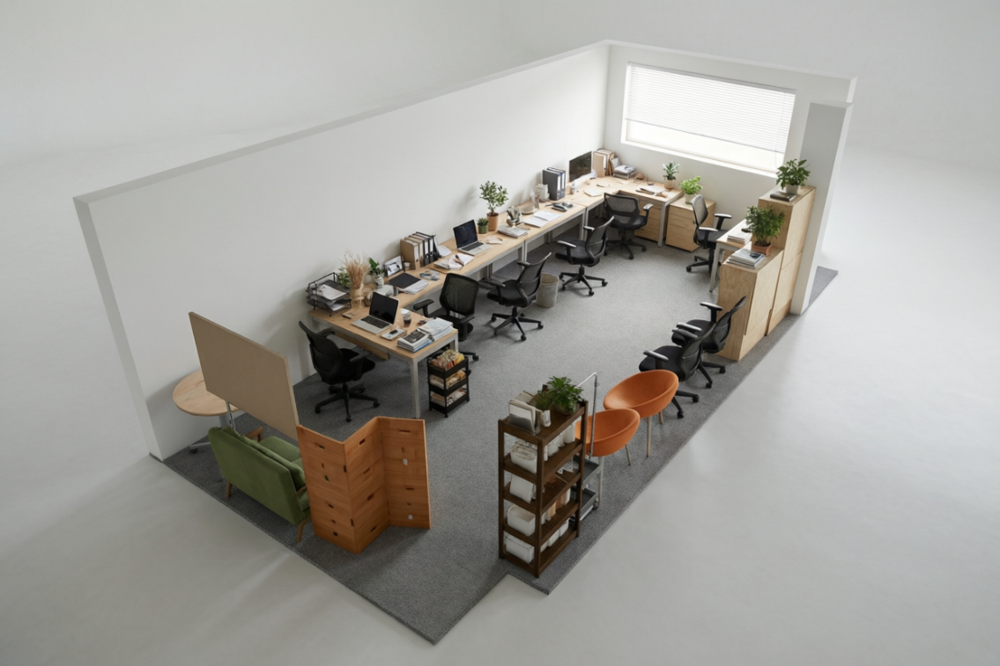 |

方案保存在空间画册里。「导出 JSON」可备份可编辑的方案，「导出 GLB」可把三维模型带到其他工具中。

## 服务设置

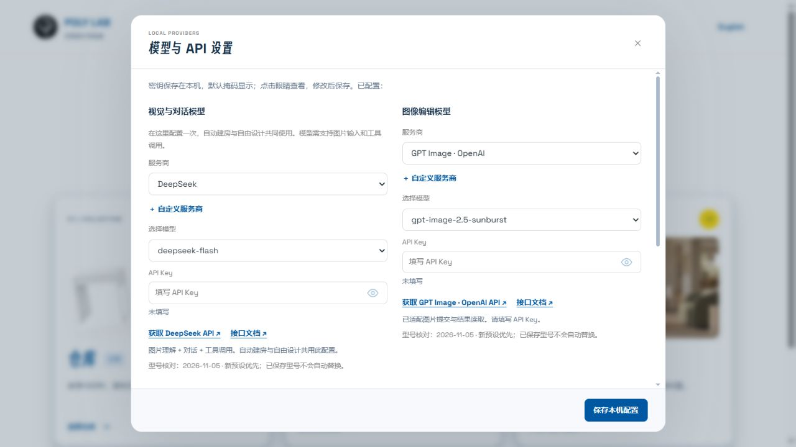

三类服务可以分开配置，用到哪项就填哪项。手动画房、摆家具、建简模和导入 GLB 都能直接在本机完成。

| 服务 | 对应功能 |
| --- | --- |
| 视觉与对话 | 读取房间视频关键帧、生成布置提案。自动建房需要支持图片输入和工具调用的模型。 |
| 图片转 3D 模型 | 用家具参考图生成模型，工作台可提交任务、查询进度并下载 GLB。 |
| 图像编辑 | 根据捕获的三维视角和参考图生成概念效果图。 |

密钥存放在工作台所在电脑的 `.env.local`，自建资产和项目保存在当前浏览器。使用 AI 功能时，选中的输入会发送给你配置的服务商。要换浏览器或迁移方案时，可以先导出 JSON。

## 本地启动

准备 **Node.js 24.12 或更新版本**和支持 WebGL 的现代浏览器。在项目目录运行以下命令。

```sh
npm ci
npm run build:studio
npm start
```

启动后打开本地工作台。Windows 用户完成首次构建后，也可以双击 `启动工作台.cmd`。视频解码、家具校准、混元排障和备份的具体步骤见使用手册。[打开本地工作台](http://127.0.0.1:8765/) · [使用手册](docs/使用手册.md)

## 开发验证

```sh
npm run build:studio
npm run test:studio
npm run test:workflow
npm run test:geometry
npm run test:furniture
```

工作台入口在 `scripts/studio/`，共享几何代码在 `scripts/`，公开示例在 `examples/`。截图展示工作台和生成的概念效果图，动图取自 Poly Lab 宣传视频。

[MIT 许可证](LICENSE) · [第三方材料说明](THIRD_PARTY_NOTICES.md)
